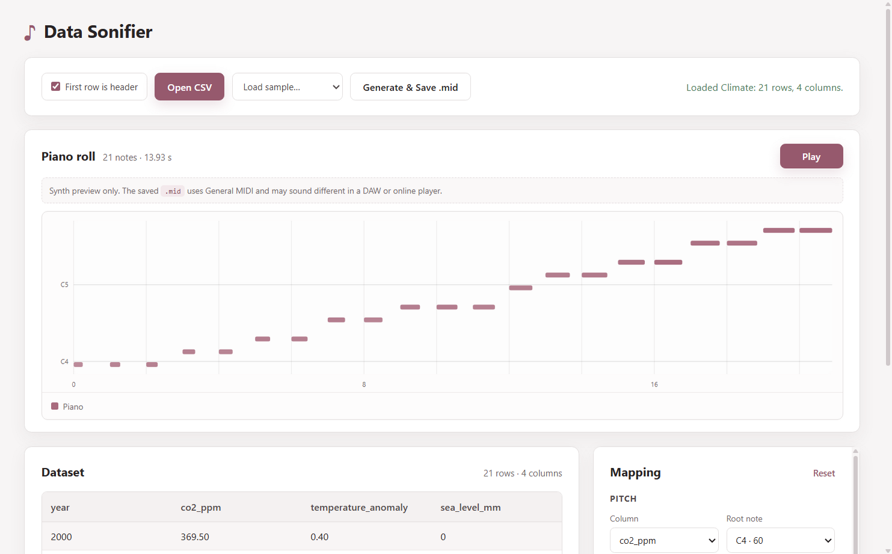

# Data Sonifier

**Laboratory work No. 2 — Data Sonification**

A desktop application that turns numeric data into a MIDI composition.

Load a CSV, choose which column controls which MIDI parameter, preview the result as a piano roll, and export a standard `.mid` file. The app is built with **Electron + React + TypeScript** and works fully offline.



---

## Quick start

### Requirements

- Node.js **22 LTS or newer**
- npm
- Windows (the packaging configuration is currently Windows-first)

### Install

```powershell
npm install
```

### Run the app

```powershell
npm run dev
```

### Build the production bundle

```powershell
npm run build
```

### Create a Windows installer

```powershell
npm run build:win
```

The installer is produced by `electron-builder`.

---

## Main abilities

- Read numeric CSV files with or without a header row.
- Support comma, semicolon, and tab delimiters.
- Accept decimal commas (`12,5` → `12.5`).
- Map any column to:
  - pitch;
  - velocity;
  - duration;
  - note onset time;
  - General MIDI instrument.
- Choose a fixed instrument or derive it from a column.
- Preview the result as an interactive piano roll.
- Play a synthesized preview with Tone.js.
- Export a valid Standard MIDI File.
- Open the saved `.mid` in the system’s default MIDI player.
- Load bundled sample datasets with suggested mappings.
- Generate MIDI from the command line.
- Run fully offline, with no backend or database.

---

## How to use

### 1. Open data

Click **Open CSV** and choose a file, or use **Load sample…** to load a bundled example.

If the first row contains data instead of column names, uncheck **First row is header** before opening the file.

### 2. Map columns

The Mapping panel controls how data becomes sound:

| Control        | Meaning                                     |
| -------------- | ------------------------------------------- |
| **Pitch**      | Column, root note, octave count, and scale  |
| **Velocity**   | Column and output range                     |
| **Duration**   | Column and range in beats                   |
| **Time**       | Row grid or a column, with a beat range     |
| **Instrument** | Fixed GM program or a column-driven palette |
| **Global**     | Tempo in BPM                                |

Every mapping can be changed without editing code. **Reset** returns to the initial layout.

If some input columns are unused, the app shows a warning.

### 3. Preview

The **Piano roll** panel shows:

- pitch on the vertical axis;
- time on the horizontal axis;
- note length as width;
- instrument as color;
- velocity as opacity.

Press **Play** to hear the synth preview. The rose line shows playback progress.

The preview uses Tone.js synthesizers, not General MIDI samples. The exported `.mid` can sound different in a DAW or online player.

#### How the piano roll is built

`PianoRoll.tsx` renders an SVG. Each note becomes a `<rect>`: `x` and width come from its time and duration, `y` from its MIDI note, color from the instrument, and opacity from velocity. Geometry is calculated in `lib/pianoRoll.ts`; a `ResizeObserver` keeps the roll responsive, and a vertical line follows playback progress.

#### How the preview sound is produced

`usePlayback` calls `Tone.start()` on the Play click. `lib/playback.ts` creates one `PolySynth` per instrument program and schedules each note on `Tone.Transport` with its time, duration, and velocity. A `requestAnimationFrame` loop updates the playhead; Stop cancels the transport and disposes the synths.

### 4. Export

Click **Generate & Save .mid**, choose a path, and save the file.

After saving, **Open in player** sends the `.mid` to the operating system’s default application. If no MIDI player is associated with `.mid`, the app reveals the file in its folder.

---

## Input format

The input must be a CSV whose columns contain finite numbers.

```csv
temperature,humidity,pressure
12.4,78,1014
11.8,81,1013
13.2,72,1013
```

Requirements:

- at least **two numeric columns**;
- every cell must be numeric;
- the header row is optional;
- header names must be non-empty and unique;
- inconsistent row lengths are rejected.

For date-like columns, use a numeric index such as `year`, `session`, `hour`, or `event`.

---

## Algorithm overview

The complete pipeline:

```text
CSV
→ parse and validate
→ normalize each mapped column
→ map to MIDI parameters
→ build NoteEvent objects
→ build MIDI tracks
→ serialize to .mid
```

More detail: [`docs/ALGORITHM.md`](docs/ALGORITHM.md) and [`docs/CUSTOMIZATION.md`](docs/CUSTOMIZATION.md).

---

## Architecture

### High-level

```text
┌─────────────────────────────────────────────┐
│ Electron main process                       │
│ window, dialogs, file system, shell          │
└───────────────▲─────────────────────────────┘
                │ IPC
┌───────────────┴─────────────────────────────┐
│ Preload bridge                              │
│ contextBridge → window.api                  │
└───────────────▲─────────────────────────────┘
                │ typed IPC
┌───────────────┴─────────────────────────────┐
│ Renderer (React + TypeScript)               │
│ CSV table, mapping editor, piano roll       │
│ Tone.js preview                             │
└───────────────▲─────────────────────────────┘
                │ pure functions
┌───────────────┴─────────────────────────────┐
│ Core                                        │
│ CSV, normalization, mapping, MIDI           │
└─────────────────────────────────────────────┘
```

The renderer never accesses `fs` or Electron dialogs directly. All file operations go through the preload bridge.

### Folder structure

```text
media-lab2/
├── data/                      sample CSV datasets + dataset README
├── docs/                      algorithm docs, report, screenshot
├── resources/                 app icon resources
├── scripts/
│   ├── generate-demo.ts       weather demo
│   └── sonify.ts              general CLI
├── src/
│   ├── core/                  pure sonification logic
│   │   ├── loadCsv.ts
│   │   ├── normalize.ts
│   │   ├── scale.ts
│   │   ├── config.ts
│   │   ├── presets.ts
│   │   ├── sonify.ts
│   │   ├── buildMidi.ts
│   │   ├── instruments.ts
│   │   └── types.ts
│   ├── main/                  Electron main process
│   │   └── index.ts
│   ├── preload/               context bridge + global API types
│   ├── renderer/
│   │   ├── index.html
│   │   └── src/
│   │       ├── components/    UI components
│   │       ├── hooks/         async actions and playback
│   │       ├── lib/           preview, playback, formatting
│   │       ├── typedefs/      typed hook Props interfaces
│   │       ├── App.tsx
│   │       ├── types.ts
│   │       └── main.tsx
│   └── shared/                IPC channel names and result types
├── tests/                     Vitest tests
├── electron.vite.config.ts
├── electron-builder.yml
└── package.json
```

### IPC channels

| Channel       | Purpose                                  |
| ------------- | ---------------------------------------- |
| `csv:open`    | Open and parse a CSV                     |
| `sample:open` | Load a bundled sample                    |
| `midi:save`   | Save MIDI bytes                          |
| `midi:open`   | Open the saved file in the system player |

---

## Application flow

1. Electron creates the main window.
2. The preload script exposes a typed `window.api`.
3. The user opens a CSV or loads a sample.
4. The main process reads the file and parses it.
5. The parsed `Dataset` returns to the renderer over IPC.
6. The renderer builds a default mapping and calls `sonify`.
7. The piano roll and playback update from the generated `NoteEvent[]`.
8. Mapping changes recompute the preview.
9. **Generate & Save** calls `sonify` + `buildMidi`, then sends bytes to the main process.
10. The main process writes the `.mid` and returns its path.
11. **Open in player** passes the path to `shell.openPath`.

---

## Sample datasets

The `data/` folder contains ready-to-use examples:

| File                     | Domain                                      |
| ------------------------ | ------------------------------------------- |
| `weather.csv`            | temperature, humidity, pressure             |
| `climate.csv`            | CO₂, temperature anomaly, sea level, year   |
| `finance.csv`            | price, volume, volatility, session          |
| `seismic.csv`            | magnitude, depth, distance, event           |
| `air-quality.csv`        | PM2.5, PM10, NO₂, temperature, hour         |
| `music-features.csv`     | energy, valence, danceability, acousticness |
| `headerless-example.csv` | headerless test file                        |

Each bundled sample has a preset that maps **all** columns. See [`data/README.md`](data/README.md).

---

## CLI

Generate MIDI without the UI:

```powershell
npm run sonify -- --input data/climate.csv --out out/climate.mid
npm run sonify -- --preset music-features --out out/music-features.mid
npm run sonify -- --preset headerless
npm run sonify -- --input data/my-data.csv --headerless
npm run sonify -- --preset climate --config my-mapping.json
npm run sonify -- --list-presets
```

If `--input` points to a bundled sample, its preset mapping is applied automatically.

Options:

```text
-i, --input <file>    input CSV
-o, --out <file>      output .mid
-p, --preset <id>     bundled sample preset
-c, --config <file>   JSON mapping config
    --headerless      no header row
-t, --tempo <bpm>     override tempo
    --list-presets    list presets
-h, --help            help
```

---

## Tests

```powershell
npm test
npm run typecheck
npm run lint
npm run build
```

Current status:

```text
9 test files
46 tests
all passing
```

Tests cover CSV parsing, normalization, pitch bounds, velocity/duration ranges, MIDI headers, deterministic output, sample datasets, and preset column coverage.

---

## Notes and limitations

- Normalization is **dataset-relative**: an outlier can rescale every note.
- Pitch mapping is quantized and therefore lossy.
- All input columns must be numeric.
- One row produces one note by default; overlapping durations can create chords.
- The in-app preview is a **synthesizer approximation**, not General MIDI samples.
- The saved `.mid` uses General MIDI program numbers; real playback depends on the player and soundfont.
- Time signature is fixed at **4/4** and is not exposed in the UI.

---

## Documentation

- [`docs/ALGORITHM.md`](docs/ALGORITHM.md) — full data-to-MIDI pipeline and MIDI internals.
- [`docs/CUSTOMIZATION.md`](docs/CUSTOMIZATION.md) — every mapping control explained.
- [`docs/REPORT_UA.md`](docs/REPORT_UA.md) — Ukrainian lab report.
- `docs/Chelushkina_lab2.docx` — formatted report document.
- [`data/README.md`](data/README.md) — sample datasets and suggested mappings.

---

## Troubleshooting

**No sound in the app preview**

- Make sure the app was restarted after the CSP fix.
- Check the Windows volume mixer and output device.
- The preview is synthesized; it will not sound identical to a General MIDI player.

**`Open in player` does not open anything**

- Windows may not have a default MIDI application.
- The app reveals the file in its folder as a fallback.
- Open the `.mid` manually in a DAW, MuseScore, or an online MIDI player.

**CSV is rejected**

- Every column must contain numbers.
- At least two numeric columns are required.
- If the file has no header row, uncheck **First row is header**.
- Check that the delimiter and decimal separator are supported.

---

## Author

Valeria Chelushkina
